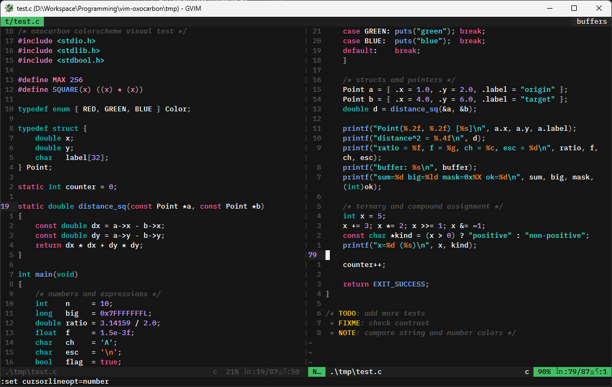

# vim-oxocarbon

A Vim colorscheme port of [oxocarbon.nvim](https://github.com/nyoom-engineering/oxocarbon.nvim), based on the structure of [vim-two-firewatch](https://github.com/rakr/vim-two-firewatch).



## Installation

**vim-plug**

```vim
Plug 'dylaris/vim-oxocarbon'
```

Then run `:PlugInstall`.

## Usage

```vim
colorscheme oxocarbon
```

Optional italics (set before loading):

```vim
let g:oxocarbon_italics = 0
colorscheme oxocarbon
```

## License

MIT
